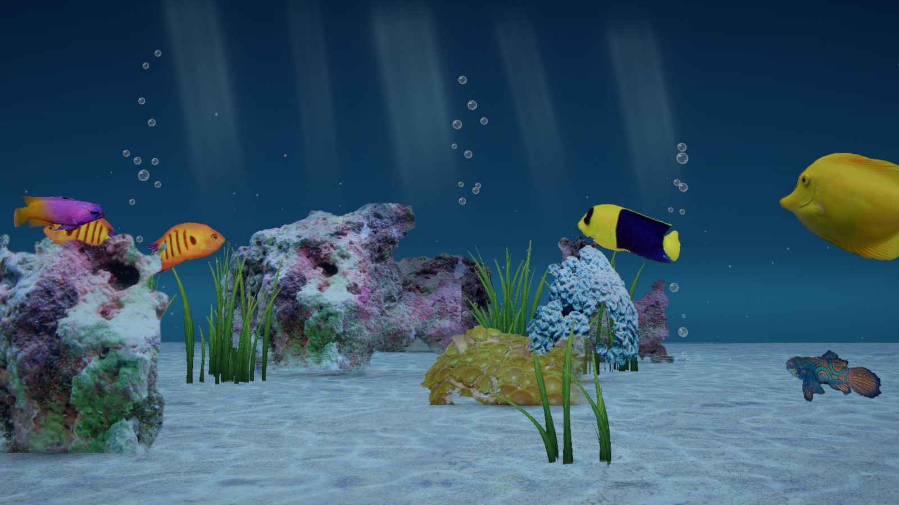
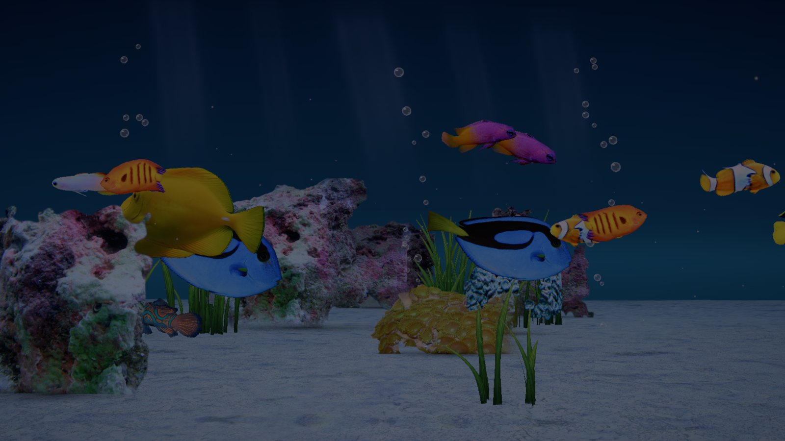

# Reef Aquarium

A calm, always-running saltwater reef tank for your screen. It is an offline, ad-free aquarium made from
**real photographs** of reef fish, rock and coral, arranged in a layered 3D scene with moving light, bubbles,
seagrass and drifting plankton. Leave it fullscreen on a TV or a spare monitor and let it run for hours.



* **Nothing to nag you.** No ads, no accounts, no network access, no on-screen clutter. Press a key and a small
  display appears for a few seconds, then fades.
* **Photographic fish.** Up to thirteen individual fish of eight species, plus a school of seven green chromis. Each is a cut-out photo
  wrapped on a flexing 3D body: it undulates as it swims, flutters its fins, hovers, darts, and slows gently to a stop.
  Fish always face the way they swim: they cross the tank, leave out of sight and come back, so you never see a flat cut-out turn.
* **A living tank.** Rising bubble streams, swaying seagrass, drifting plankton, light that ripples across the fish and rocks,
  soft sun shafts, a slow camera drift and a gentle vignette.
* **Optional day and night.** A slow cycle through dawn, daylight, dusk and moonlit night. Off by default.
* **Light on the machine.** A single Rust program built on [Bevy](https://bevyengine.org/). It renders at a fixed internal
  resolution and scales up, so it runs smoothly on integrated graphics.
* **It remembers your setup** between runs.



## Download

Get the build for your system from the **[latest release](../../releases/latest)**:

| System | File |
|---|---|
| Linux (x86-64) | `reef-aquarium-linux-x86_64.tar.gz` |
| Windows (x86-64) | `reef-aquarium-windows-x86_64.zip` |
| macOS, Apple Silicon (M1 and newer) | `reef-aquarium-macos-arm64.tar.gz` |
| macOS, Intel | `reef-aquarium-macos-x86_64.tar.gz` |

Unpack it anywhere and run the `aquarium` program inside (keep the `assets` folder next to it). It starts fullscreen.

> **Honest status:** developed and tested on Linux (Fedora, Intel integrated graphics). The Windows and macOS
> builds are produced automatically by GitHub Actions and have **not** been tested by the author yet - please report problems.
>
> * **Windows:** SmartScreen may warn about an unsigned program. Choose *More info -> Run anyway*.
> * **macOS:** the app is unsigned. If macOS says it "cannot be opened", run `xattr -dr com.apple.quarantine reef-aquarium-macos-*`
>   in the folder, or right-click the program and choose *Open*.
> * **Linux:** needs a working Vulkan or OpenGL driver (Mesa on most desktops).

## Start it with one click, or at login

* **Linux:** in the unpacked folder run `./install.sh` to add *Reef Aquarium* to your applications menu, or
  `./install.sh --autostart` to also start it when you log in. `./install.sh --uninstall` removes both.
* **Windows:** right-click `aquarium.exe` -> *Show more options* -> *Create shortcut*. To start it at login, press `Win+R`, type
  `shell:startup`, and drop the shortcut into that folder.
* **macOS:** drag the unpacked folder somewhere permanent, then *System Settings -> General -> Login Items* to add the `aquarium` program.

## Controls

| Key | Action |
|---|---|
| `F` / `D` | add / remove a fish |
| `Up` or `Right` / `Down` or `Left` | faster / slower |
| `P` | pause / resume |
| `S` | save a screenshot to a `screenshots` folder |
| `E` | feed the fish: flakes sink from the top and the fish swim up to take them |
| `K` | call the shark now (`Shift+K` turns shark visits on or off) |
| `N` | switch the day/night cycle on or off (`Shift+N` jumps ahead in the day) |
| `?` or `H` | show the key list (fades after a few seconds) |
| `F11` | fullscreen / window |
| `Esc` or `Q` | quit |

A small bar display shows the fish count and speed and turns amber at **MAX** and dim red at **MIN**.

## Options

```
aquarium [options]
  --windowed / --fullscreen   window or full screen (default: fullscreen)
  --fish N              individual fish, 0-13 (default 10)
  --school N            small green fish in the school, 0-7 (default 7)
  --grass N             seagrass clumps, 0-40 (default 16)
  --bubbles N           bubbles, 0-120 (default 45)
  --no-shark            no shark visits (rare by default: one every 10-25 minutes)
  --motes N             drifting plankton specks, 0-300 (default 90)
  --speed X             speed of everything, 0.2-3 (default 1.0)
  --day-night           turn on the day and night cycle (--no-day-night turns it off)
  --day-length MIN      minutes per full day (default 30); also turns the cycle on
  --render-width N      internal render width, default 1600 (lower = faster on weak GPUs)
  --no-effects          turn off sun shafts and the shimmer on the sand
  --reset               ignore and overwrite the remembered settings
  --fps                 print the frame rate every 10 seconds
  --help                show this text
```

Your choices (from keys or options) are saved to `~/.config/reef-aquarium/settings.conf`
(Windows: `%APPDATA%\reef-aquarium\settings.conf`). Use `--reset` to start fresh.

## Build from source

You need [Rust](https://rustup.rs/) (a recent stable toolchain).

```bash
git clone https://github.com/vancarlson/reef-aquarium
cd reef-aquarium
cargo build --release
./run.sh            # Linux/macOS; or run target/release/aquarium from the project folder
```

On Linux you may need the usual windowing headers (`libwayland-dev libxkbcommon-dev libx11-dev` on Debian/Ubuntu).
The program finds its `assets/` folder next to the executable, or via the `BEVY_ASSET_ROOT` environment variable.

`tools/` holds the Python scripts used to prepare the artwork from the source photos (cut-outs, thickness maps, textures).
The source photos are not stored in this repository; they come from the links in [`CREDITS.md`](CREDITS.md).

## Known limitations

* The fish are photographs on a 3D body, not full 3D models. They look best side-on, which is why they never turn on screen.
* The seagrass and the rocks are the least photographic parts. The rocks are cut from a single photograph.
* Fish swim in fixed depth lanes in front of the rocks and coral, so they pass in front of or behind them but never through them.
  That also means a fish never moves nearer to or farther from you.
* Long-run behaviour is checked on one Linux machine only. On a laptop, check the heat if you leave it running for hours.

## Credits and licences

Code: [MIT](LICENSE). Artwork: photographs under public-domain, CC0 and CC BY licences. Every source, author and licence
is listed in [`CREDITS.md`](CREDITS.md); the licences of the Rust libraries are in [`THIRD_PARTY_LICENSES.md`](THIRD_PARTY_LICENSES.md).
